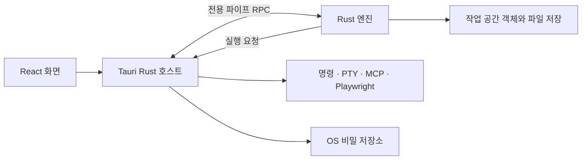

# ARTEX 데스크톱 아키텍처 설계

이 문서의 React·Tauri·별도 엔진 구조는 사용자가 거부한 이전 설계다. 현재 구현 기준은 [Rust 통합형 데스크톱 앱 설계](desktop-native-architecture.md)이며, 아래 내용은 이전 설계의 비교 기록으로 보존한다.

작성일 2026년 10월 12일. 이 설계는 macOS, Windows, Arch Linux에서 실행하는 개인용 데스크톱 버전의 구현 기준이다. 안정성을 우선해 Rust 엔진, Tauri 2 앱, 메모리 객체 그래프와 파일 영속화를 채택한다. 현재 저장소의 Go 웹 서버는 기능 비교와 데이터 이전의 기준이다. 이 문서는 목표 구조를 정의하며 Rust 실행 코드와 설치 패키지의 구현 완료를 의미하지 않는다.

데이터·RPC·저장 바이트 형식·내부 메시지·도구별 구현 계약은 [상세 구현 명세 v1.0](desktop-implementation-spec.md)으로 확정했다. [54개 테이블·571개 필드 계약](contracts/data-model.v1.json), [전체 API 대응](contracts/legacy-routes.v1.json), [81개 도구 대응표](desktop-tool-mapping.md)를 함께 적용한다. 아래 초기 제한·파일명·ID·프로토콜의 세부 값은 상세 명세가 우선하며, 실행 코드와 OS별 검증은 전환 계획의 다음 단계다.

## 제품의 실행 단위

앱은 사용자 세션에서 실행하며 시스템 서비스, PostgreSQL, Docker를 기본 실행 조건으로 요구하지 않는다. 설치된 앱은 화면, Rust 엔진 실행 파일, 검증된 기본 리소스를 포함한다. LLM 접속과 선택적 외부 도구의 실행 환경은 별도의 의존성으로 관리한다.

작업 공간 하나가 회사·자산·작업·탐색·취약점의 공유 경계다. 여러 작업은 같은 작업 공간 안에서 자산과 사실을 연결할 수 있다. 서로 다른 작업 공간의 객체는 직접 참조하지 않으며, 내보내기와 가져오기로 관계를 명시적으로 옮긴다. 앱 하나는 기본적으로 작업 공간 하나를 쓰기 모드로 연다.

같은 작업 공간에 저장되어 있다는 이유로 모든 에이전트에 모든 객체를 제공하지 않는다. 작업별 사실·워커·권한의 범위를 유지하며, 다른 작업의 정보 조회는 명시적인 관계와 정책으로 허용한다. 저장 소유권과 에이전트 조회 범위를 구분한다.

앱의 사용자 인증 경계는 OS 사용자 세션이다. 웹 서버용 로그인·JWT 화면을 데스크톱의 기본 진입 절차에서 제거하고, 새 작업 공간 만들기와 최근 작업 공간 열기로 시작한다. 모델 자격 증명 잠금과 도구 실행 정책은 별도로 유지한다.

## 프로세스와 책임

| 구성 | 책임 | 소유하지 않는 상태 |
| --- | --- | --- |
| React 화면 | 입력, 조회 결과, 실행 상태, 파일 선택과 사용자 알림 표시 | 영속 객체, 비밀 값, 임의 프로그램 실행 권한 |
| Tauri Rust 앱 호스트 | 창·메뉴·수명주기, 엔진 감시, OS 비밀 저장소, 파일 선택, 외부 프로세스 감독, 업데이트 | 작업 공간 객체의 직접 변경 |
| Rust 엔진 실행 파일 | 에이전트, 도구 계약, 정책 판정, 객체 그래프, 저장·복구·검색, 트래픽 서비스 | 창과 설치 패키지의 수명주기 |
| 도구와 MCP 프로세스 | 승인된 호출 수행, 표준 출력·오류 또는 PTY 출력 제공 | 작업 공간의 직접 저장·수정 권한 |

Tauri 호스트가 엔진을 동반 실행 파일로 시작한다. 화면을 새로 고치거나 다시 만들어도 엔진은 계속 실행한다. 엔진 장애 시 호스트는 화면을 유지하고 도구 실행을 정리한 뒤 재시작 또는 복구 화면으로 전환한다. 무한 재시작은 하지 않는다. 외부 프로그램은 호스트의 프로세스 감독 계층이 실행하고, 엔진은 호출 ID와 실행 사양을 전달한다.

엔진과 도구 실행은 현재 OS 사용자 권한을 사용한다. 앱 전체의 상시 관리자 권한 실행을 기본으로 삼지 않는다. 작업 디렉터리와 정책 검사만으로 OS 수준 샌드박스가 완성되었다고 간주하지 않는다.



Tauri의 외부 실행 파일 지원을 사용하되, 화면에 일반적인 셸 실행 API를 노출하지 않는다. [Tauri 외부 실행 파일 문서](https://v2.tauri.app/develop/sidecar/)

## 화면과 엔진의 통신

기본 통신은 호스트가 생성한 전용 stdin·stdout 파이프의 JSON RPC다. 앱 제어용 HTTP 포트는 기본으로 열지 않는다. 엔진의 stdout은 프로토콜 전용이고 진단 로그와 외부 도구 출력은 별도 채널로 전달한다. 큰 파일과 트래픽은 참조 ID와 구간 읽기로 전달한다.

요청에는 프로토콜 버전, 요청 ID, 작업 공간 ID, 메서드, 매개변수와 취소 정보를 포함한다. 영속 변경 요청은 명령 ID와 예상 객체 버전을 추가한다. 동일한 명령 ID의 재전송은 저장된 결과를 반환하고 변경을 다시 적용하지 않는다. 오류는 코드·사용자 메시지·재시도 가능 여부·확인 필요 여부로 구조화한다.

메시지는 길이가 있는 프레임으로 구분하고 최대 크기와 입력 큐를 제한한다. v1은 4바이트 little-endian 길이와 UTF-8 JSON, 제어 프레임 1 MiB, 본문 읽기 구간 64 KiB로 확정한다. 초과 요청은 명시적인 오류로 반환하며 제한 변경은 계약 버전과 협상으로 관리한다. 파이프 양방향은 지속적으로 읽어 출력 대기로 인한 교착을 피한다. UI가 느려져도 확정된 작업 결과를 버리지 않고, 표시용 진행 이벤트는 합칠 수 있다.

이벤트에는 엔진 세션 ID와 순번이 있다. 객체 조회 응답은 기준 저장 순번을 포함한다. 화면이 재접속하거나 이벤트를 놓치면 스냅샷을 다시 조회하고 이후 이벤트를 적용한다. 대화와 기록의 저장 완료 상태를 화면의 순간적인 스트리밍 출력과 구분한다. JSON에서 큰 순번과 버전 값은 10진 문자열로 전달한다.

기존 프런트엔드의 API 클라이언트를 데스크톱 전송 인터페이스로 교체한다. 도메인 모델과 화면 컴포넌트는 재사용하고, HTTP fetch·EventSource·JWT·서버 리다이렉트 의존 부분을 어댑터로 분리한다. 기존 Go 서버용 클라이언트는 비교 검증에만 사용한다. 초기 데스크톱판은 원격 관리 서버 기능을 제공하지 않는다.

현재 Next.js 정적 내보내기 결과인 `web/out`을 Tauri의 화면 리소스로 포함하며 Next.js 서버를 앱 안에서 실행하지 않는다. 데스크톱 진입 경로·새로고침·정적 자산 경로는 각 OS의 WebView에서 검증한다. Tauri 문서의 Next.js 예제 버전과 저장소의 실제 버전 차이는 통합 단계에서 확인한다. [Tauri Next.js 연동 문서](https://v2.tauri.app/start/frontend/nextjs/)

## 단일 실행과 작업 공간 잠금

OS 사용자 프로필마다 앱 인스턴스 하나를 기본으로 한다. 두 번째 실행은 기존 창을 활성화하고 파일 열기 요청을 전달한다. 프로파일을 나누어 별도 실행하는 개발 모드는 잠금 범위를 분리한다. [Tauri 단일 인스턴스 문서](https://v2.tauri.app/plugin/single-instance/)

앱 인스턴스 제어와 별개로 엔진은 작업 공간의 파일 잠금을 독점한다. 잠금 파일의 존재만 보지 않고 OS 파일 잠금을 유지한다. PID는 진단 정보이고 잠금 해제 판정의 유일한 근거가 아니다. 잠금 획득에 실패하면 해당 공간을 쓰지 않고 기존 앱으로 이동하거나 일관된 읽기 전용 복사본을 연다.

네트워크 공유·클라우드 동기화 폴더를 실행 중 작업 공간으로 지원하지 않는다. 초기 쓰기 지원은 검증된 로컬 파일 시스템이다. 다른 저장 위치는 명시적으로 탐지·안내하고, 일관된 내보내기 파일을 이용해 이동한다. 읽기 전용 조회도 작성 중 파일을 임의로 조합하지 않고 검증된 저장 세대를 기준으로 한다.

## 데이터 위치와 프로젝트 파일

설치 디렉터리에는 실행 파일과 읽기 전용 리소스만 둔다. 앱 설정·최근 작업 공간·진단·캐시는 OS가 제공하는 사용자 데이터 경로로 분리한다. 경로는 플랫폼 API로 얻고 문자열로 고정하지 않는다.

| 종류 | 위치와 정책 |
| --- | --- |
| 앱 설정 | 사용자 설정 디렉터리, UI 환경과 최근 작업 공간, 비밀 참조 ID |
| 기본 작업 공간 | 사용자 앱 데이터 디렉터리 아래 작업 공간 ID별 폴더 |
| 사용자 지정 작업 공간 | 파일 선택기로 고른 로컬 폴더, 설치 경로와 독립 |
| 큰 본문과 첨부 | 작업 공간의 객체 저장 폴더, 내용 해시로 식별 |
| 검색 캐시 | 재생성 가능한 캐시 디렉터리, 형식 버전과 기준 순번 포함 |
| 자격 증명 | OS 비밀 저장소, 작업 공간에는 참조 ID만 저장 |
| 진단 로그 | 사용자 상태·로그 디렉터리, 크기 제한과 민감 값 제거 |

작업 공간은 다음 논리 구조를 가진다. 실제 파일명·스냅샷 행·저널 바이트 형식·복구 순서는 상세 구현 명세 v1.0으로 고정했다.

```text
workspace/
  project.json
  store/
    manifests/
    snapshots/
    journal/
  records/
    conversations/
    traces/
  objects/
    blobs/
    attachments/
  traffic/
    records/
  backups/
  locks/
```

project.json은 작업 공간 ID·표시 이름·형식 버전을 포함하며 원본 경로를 권한 근거로 신뢰하지 않는다. 가져온 경로·심볼릭 링크·Windows 재분석 지점이 작업 공간 밖으로 연결되는지 검사한다. 비밀과 인증서 개인 키는 내보내기에서 기본적으로 제외한다.

## 객체 그래프와 소유권

중앙 저장 계층이 객체를 소유하며 ID 기반 메모리 목록과 검색 인덱스를 관리한다. Rust 타입으로 ProjectId·TaskId·AssetId·NodeId·FindingId를 구분하고 ID를 재사용하지 않는다. 외부 표현은 문자열 ID다. 원본의 정수 ID는 가져오기 매핑에 보존한다. 계약상 ID 형식이 바뀌는 지점은 호환 어댑터와 버전으로 명시한다.

공유와 통신을 위해 TaskSourceRelation·DomainEvent·AgentMessage·AgentDelivery·SteeringMessage·ConversationRequest·AgentInbox·AgentOutbox를 같은 저장 계층에서 관리한다. 에이전트·실행·이벤트·메시지 ID도 각각 타입으로 구분한다. 대기 항목과 소비 상태는 스냅샷·변경 기록에 포함하고, 큰 메시지·기록은 파일 참조로 보관한다.

작업 간 공유 자산과 탐색 관계는 같은 작업 공간 안에서 유지한다. 작업과 취약점, 그래프 노드의 ID를 혼동하지 않는다. 특히 원본 update_finding_report의 finding_id 인자가 실제 탐색 노드 ID를 받는 동작은 가져오기와 도구 호환 어댑터에서 명시적으로 변환한다.

각 객체는 버전을 갖는다. 변경 명령은 예상 버전을 검사해 오래된 화면이나 에이전트가 새 결과를 덮어쓰지 못하게 한다. 자산의 중복 판정과 도메인·서비스·엔드포인트별 검색 키는 기존 스키마의 동작을 기준으로 정의한다. 관계 삭제·작업 보관·증거 참조 정리는 논리 작업 하나로 검증하고 저장한다.

공유 소유권 포인터로 순환 참조를 만들지 않는다. 관계는 ID이며 필요한 처리 동안 객체를 빌려 사용한다. 읽기는 불변 조회 결과로 제공하고 모든 변경은 작업 공간별 단일 명령 처리 경로를 통과한다. 네트워크·LLM·외부 명령을 기다리는 동안 저장 잠금을 잡지 않는다.

## 에이전트 간 정보 공유

기존 DB는 에이전트가 사실·자산·취약점·작업 결과를 기록하고 다른 에이전트가 조회하는 공유 저장소 역할을 한다. 데스크톱에서도 이 협업 계약을 유지한다. Rust 엔진의 WorkspaceStore가 메모리 객체를 소유하고 SharedContextService가 에이전트별 조회와 변경을 제공한다. 파일은 확정 상태의 보존·복구 수단이며 에이전트마다 파일을 읽고 수정해 공유하는 구조로 만들지 않는다.

### 기존 기능과 새 저장 구조의 대응

| 기존 공유 경로 | 데스크톱 대응과 유지할 동작 |
| --- | --- |
| record_fact, report_finding, insert_assets | 타입이 구분된 객체와 자산 연결을 저장 명령으로 변경한다. 생산 에이전트·작업·의도·증거의 출처를 남긴다. |
| graph_overview, list_facts, list_findings, node_detail | 현재 작업과 직접 연결된 원본 작업의 허용된 객체를 조회한다. 목록·상세·검색 모두 같은 범위 판정을 사용한다. |
| task_relations, source_task_ids | TaskSourceRelation 객체와 직접 원본 인덱스로 유지한다. 상위·하위 작업 표시용 parent_ref와 정보 상속 관계를 구분한다. |
| get_worker_output, get_worker_trace, search_all_worker_traces | 저장된 결과·실행 기록을 조회한다. 다른 작업에서 가져오는 기록은 허용된 종료 의도에 한정하며 thinking·usage 행은 제외한다. |
| add_hint, add_task_hint | 대상 작업 소유의 Hint 객체와 증거 참조를 저장하고 해당 계획 에이전트의 처리 대기 이벤트를 같은 변경에 포함한다. |
| NotifyFinding, NotifyDone, 목표·지침 알림 | 발견·완료·목표·지침 이벤트로 계획 에이전트를 깨운다. 알림은 저장된 객체를 가리키며 결과 자체를 대신하지 않는다. |
| steer_work | 실행 중 의도를 지정한 SteeringMessage로 수정 지시를 전달한다. 실행 세대를 대조하고 다음 도구 호출 전에 처리한다. |
| 보고서 에이전트와 도구 완료 트리거 | 기존 트리거 조건·병합·병렬 정책을 유지하고 확정된 발견 ID와 증거 버전을 전달한다. |

조회 범위의 기준은 [직접 원본 작업 조회](../../original/db/exploration_sources.go), [정보 상속 계약 테스트](../../original/agent/blackboard_inheritance_test.go), [작업 지정 도구](../../original/server/orchestration.go), [실행 알림](../../original/server/manager.go), [워커 수정 지시](../../original/server/engine.go)다. 이 경로를 기능 계약과 Rust 비교 시나리오에 매핑한다.

기존 배치 도구의 항목별 ids·errors와 부분 성공 응답을 유지한다. 잘못된 항목은 객체를 만들지 않으며, 성공 항목의 객체·관계·필수 이벤트만 논리 변경으로 확정한다. 여러 항목을 묶는 저장 최적화가 도구의 성공·실패 계약을 바꾸지 않게 한다.

### 조회 범위와 변경 권한

같은 작업의 에이전트들은 확정된 공유 상태를 조회한다. 다른 작업의 정보는 명시적인 직접 관계로 읽으며 관계의 관계를 재귀적으로 펼치지 않는다. A가 B를 참조하고 B가 C를 참조해도 A에 C의 정보가 자동으로 보이지 않는다. 원본 작업의 이후 확정 변경은 다음 조회에 반영하고, 관계 제거와 원본 작업 삭제도 다음 조회와 실행 전 정책 검사에 반영한다.

상속 조회는 source_task_id와 inherited=true를 유지한다. 원본 작업의 노드·실행 의도는 읽기 전용이다. 상속 사실을 근거로 현재 작업의 새 의도를 만들 수 있지만, 상속 의도에 결과를 쓰거나 원본 워커를 제어하지 않는다. 작업 지정 도구를 허용받은 플랫폼 에이전트는 별도의 대상 작업 권한으로 add_task_hint 등 기존 동작을 수행할 수 있다. 이 권한을 일반적인 상속 조회에 포함시키지 않는다.

원본 작업의 실행 기록은 기존 done·blocked·exhausted·stopped 상태와 대응되는 종료 상태에서만 제공한다. 상태 검사와 기록 읽기를 같은 확정 조회 시점에서 수행하며, 재개된 원본 의도의 새 실행 기록을 노출하지 않는다. 공용 자산의 객체 ID는 재사용하되 작업별 자산 연결·범위·실행 권한은 독립적으로 유지한다. 공용 자산을 안다는 이유로 검사 범위를 확대하지 않는다.

SharedContextService는 CallerContext의 에이전트 ID·작업 ID·실행 ID·역할·도구 권한을 엔진에서 부여받는다. 모델이 입력한 task_id나 메시지의 발신 이름만으로 권한을 인정하지 않는다. 계획·메인·실행·플랫폼 에이전트의 기존 도구 바인딩을 유지하고, 워커에 제공하지 않던 목록 도구를 공유 저장소 전환을 이유로 추가하지 않는다.

### 조회 일관성과 에이전트 문맥

조회는 확정 순번 S의 객체·관계·권한 상태를 함께 읽고 결과에 기준 순번과 객체 버전을 포함한다. 도구 성공 응답을 받은 뒤 같은 작업을 조회하면 그 변경 이상을 읽도록 min_committed_seq를 지원한다. 실행 직전에는 현재 정책과 객체 버전을 다시 검증하며, 과거 문맥에서 이미 읽은 내용을 관계 제거로 회수할 수 있다고 보장하지 않는다.

페이지 정렬은 ID 문자열의 우연한 순서에 의존하지 않고 생성 순번과 ID의 안정적인 키를 사용한다. 이전 데이터의 정렬은 원본 순서 매핑으로 보존한다. 조회 커서는 기준 순번·정렬 위치·범위 버전을 포함하며, 페이지 사이에 관계나 권한이 바뀌면 기존 커서를 거절하고 다시 조회하게 한다. 보존 기간이 지난 조회 세대도 같은 방식으로 처리한다. 도구별 limit·total·has_more·next_before·출처 필드는 버전이 있는 호환 어댑터로 유지한다.

공유 객체와 각 에이전트의 LLM 대화·압축 문맥은 구분한다. 변경을 모든 LLM 문맥에 무조건 복사하지 않는다. 워커 시작·계획 라운드·명시적 조회 때 최신 공유 상태를 구성하고, 실행 중에는 허용된 수정 지시를 안전한 경계에 삽입한다. 원본의 요약 예산·페이지 제한·세부 조회와 콜드 요약 출처를 유지한다.

### 저장 후 알림과 재시작 복구

객체 변경과 그 변경에 필요한 DomainEvent를 하나의 트랜잭션 프레임에 저장한다. DomainEvent는 event_id·committed_seq·task_id·원인 명령 ID·종류·객체 참조·대상 소비자를 포함한다. 계획·보고서 등 실제 활성화 대상의 대기 전달 항목도 이 프레임에서 확정한다. 확정 전에는 알림을 전달하지 않는다. 큰 기록 본문은 참조로 전달한다.

메모리 알림 큐는 깨우기 수단이며 전달 대기와 처리 상태의 원본은 WorkspaceStore다. 저장 후 알림 전에 앱이 종료되어도 재시작 시 대기 항목을 다시 찾는다. 소비자는 event_id와 활성화 키로 중복을 판정하고, 처리 결과의 그래프 변경과 처리 완료를 같은 저장 명령으로 확정한다. 여러 이벤트를 하나의 계획 라운드로 합치더라도 소비한 이벤트 ID를 모두 남긴다.

AgentDelivery의 v1 상태는 pending·claimed·observed·completed·expired·cancelled·interrupted다. 수락은 현재 버전과 엔진 세대·소비자 실행 ID를 대조하는 저장 명령으로 처리한다. 같은 전달을 두 소비자가 동시에 수락할 수 없고, 종료된 세대의 완료 요청도 거절한다. 재시작 시 claimed를 단순히 pending으로 바꾸지 않고 해당 실행 체크포인트와 외부 호출의 확정 여부를 대조하며 불명확한 외부 실행은 해당 run의 recovery_required로 남긴다.

전달은 재전달 가능성을 전제로 한다. LLM·외부 도구 실행까지 정확히 한 번이라고 보장하지 않는다. 처리 중 종료된 활성화는 실행 기록과 대조하고 불명확하면 recovery_required로 남긴다. 작업이 정지·보관 상태이면 이벤트를 저장하되 실행을 자동 시작하지 않으며, 기존 재개 정책에 따른다. 대상 삭제·권한 철회는 대기 항목을 무효화하고 이유를 보존한다.

SteeringMessage에는 message_id·intent_id·target_run_id·전달 순번과 상태를 저장한다. 기존 steer_work처럼 실행 중인 의도에만 새 지시를 받는다. 도구 호출 전 FIFO로 전달하고 적용한 메시지 ID를 대화 체크포인트에 남긴다. 대상 실행이 종료·취소되면 미전달 지시는 종료 처리하며 다음 실행에 자동 적용하지 않는다. 실행 중 지시의 영속화와 알림 복구는 기존 메모리 큐보다 강화하는 동작으로 구분한다.

같은 작업 공간 안의 기본 정보 공유와 알림은 Rust 엔진 내부 서비스로 완결된다. 브로커·외부 통신 서버 없이도 기존 협업이 동작해야 한다.

## Brevduva 구조를 활용한 내부 통신 프로토콜

Brevduva의 에이전트 식별·채널·단방향 메시지·요청과 응답·진행 보고·수신 확인 구조를 ARTEX 내부 통신 계약에 적용한다. Rust 엔진의 AgentMessageRouter가 메시지를 라우팅하고 WorkspaceStore가 메시지와 처리 상태를 소유한다. Brevduva 서비스·수신 데몬·MCP 브리지·SDK를 앱의 의존성으로 추가하지 않는다. 이 계약은 ARTEX 자체 구현이며 Brevduva와의 전송 호환성을 요구하지 않는다.

공유 객체는 SharedContextService로 읽고 쓰며, 메시지는 특정 에이전트에 질문·지침·처리 결과를 전달한다. 대화에서 나온 사실을 공유 그래프에 반영하려면 기존 저장 명령과 권한 검사를 거친다. 기본 DB 대체 정보 공유와 직접 메시지 대화를 같은 저장·정책·복구 경계 안에서 제공한다.

### 메시지 유형과 처리 의미

| 참고하는 구조 | ARTEX 내부 동작 |
| --- | --- |
| 에이전트 식별과 바인딩 | 엔진이 AgentId를 현재 실행 ID·엔진 세대에 연결한다. 이전 실행의 발신·수락·완료 요청은 거절한다. |
| 채널과 topic | 작업 공간·작업별 ChannelId와 허용된 관심 주제로 수신 범위를 지정한다. 채널 참여가 객체 조회 권한을 확대하지 않는다. |
| send | 지정 에이전트에 단방향 정보·지침을 전달한다. 특정 실행에 대한 지시는 target_run_id를 대조한다. |
| request | 요청 ID를 가진 질문·협업 요청을 저장한다. 발신 에이전트는 응답을 기다리는 동안 저장 잠금과 실행 슬롯을 점유하지 않는다. |
| reply | 원 요청 ID를 correlation_id로 지정한 최종 답변이다. 원 발신자·수신자·요청 상태를 확인하고 요청을 종료한다. |
| report | 진행 보고와 최종 실패를 구분한다. 중간 보고는 요청을 종료하지 않으며 최종 실패는 이유를 남긴다. |
| receipt | 수신자가 메시지를 관찰했다는 확인이다. 업무 처리 완료와 별개의 상태로 저장한다. |
| broadcast, acknowledge | 발신 시 허용된 수신자 목록을 확정하고 수신자별 관련 여부·확인 상태를 관리한다. |
| 유효 기간과 첨부 참조 | 만료된 요청·지시를 실행하지 않고 큰 본문은 객체 파일 참조와 구간 읽기로 처리한다. |

이는 구조를 참고한 내부 연산 이름이다. 별도의 Brevduva 도구를 호출하는 계약으로 해석하지 않는다.

### 메시지 식별과 전달

AgentMessage의 v1 필드는 protocol=artex-agent/1.0·message_id·command_id·workspace_id·sender·recipients·channel·topic·kind·correlation_id·created_at·deadline_at·body·object_refs·final·outcome·hop_count다. 저장 순번과 객체 버전은 레코드 header에 둔다. 발신 정보는 엔진의 CallerContext에서 채우고 모델의 입력을 그대로 신뢰하지 않는다. 새로운 request의 message_id가 요청 식별자이며 reply·report는 그 ID를 참조한다. 전체 JSON 스키마와 one/all 완료 정책은 상세 구현 명세를 따른다.

내부 send/request 명령은 메시지와 수신자별 AgentDelivery를 같은 트랜잭션에 확정한다. AgentOutbox와 AgentInbox는 이 메시지와 전달 상태를 가리키는 발신·수신 조회 인덱스이며 본문을 별도로 복제하지 않는다. 수신 전달은 저장 동기화 이후에 시작한다. 동일 command_id의 재요청은 같은 message_id와 결과를 반환한다.

receipt와 처리 수락·진행·최종 결과를 구분한다. 관찰한 메시지가 아직 미처리이면 처리 대기 상태로 남는다. 처리 수락은 수신자별 delivery_id와 실행 ID에 묶어 같은 전달을 두 실행이 동시에 처리하지 못하게 한다. 여러 수신자의 one/all 답변 정책과 최종 답변·실패를 저장 명령으로 확정한다. 완료된 요청의 같은 종결 답변은 기존 상태를 반환하고, 다른 중복 종결 답변은 충돌로 처리한다.

라우팅은 기본적으로 같은 Rust 엔진의 비동기 호출과 저장된 대기 항목으로 수행한다. 같은 앱의 에이전트를 나중에 별도 프로세스로 분리할 경우 기존 호스트–엔진 전용 파이프 RPC를 통해 같은 내부 메시지 계약을 전달한다. 앱 내부 통신을 위해 외부 서버나 공개 제어 포트를 요구하지 않는다.

### 중단 복구와 실행 범위

재시작 후 메시지·요청·수신 확인·처리 상태를 스냅샷과 변경 기록에서 복원한다. 미전달 항목은 실행 정책에 따라 전달하고 처리 중 항목은 기존 AgentDelivery 복구 절차로 대조한다. 관찰 확인만 있는 요청을 완료 처리하지 않는다. 불명확한 LLM·외부 도구 호출은 자동 재실행하지 않는다.

작업 일시 정지·삭제·권한 철회·실행 교체·응답 기한을 전달과 수락 시 확인한다. 실행에 묶인 지시는 다른 실행으로 넘기지 않는다. 채널별 큐·본문·진행 보고의 상한과 요청 기한을 적용하고, 상호 응답 대기와 순환 요청은 감지해 대기 해제 또는 구조화된 오류로 처리한다. broadcast 확인은 관련 여부의 확인이며 도구 실행 승인으로 취급하지 않는다.

동료 에이전트의 메시지는 협업 데이터다. 발신 역할이 다른 에이전트의 도구 권한이나 사용자 승인 권한으로 승격되지 않게 한다. 메시지에 포함된 객체 참조도 기존 직접 상속·읽기 전용·작업 지정 권한을 적용한다. 메시지에서 시작한 활성화·도구 호출·그래프 변경을 연결해 추적하며 비밀 값은 메시지 본문과 로그에 넣지 않는다.

## 변경 확정과 파일 영속화

영속 저장은 버전이 있는 JSON 상태 스냅샷과 프레임 단위 변경 기록으로 구성한다. 메모리 구조체의 주소나 이진 배치를 직접 저장하지 않는다. 변경 기록에는 객체 변경 후 값·삭제·관계 변경·명령 결과가 포함되어 재생 시 LLM이나 도구를 다시 호출할 필요가 없다.

논리 변경 하나는 여러 객체와 인덱스 변경을 묶은 하나의 트랜잭션 프레임이다. 프레임에는 형식 버전, 길이, 순번, 트랜잭션·명령 ID, 전체 데이터의 무결성 검사를 포함한다. v1은 104바이트 header와 최대 16 MiB payload, 8바이트 footer로 확정하며 큰 기록과 본문은 별도 파일로 저장한다. 무결성 해시는 손상 검출용이며 작성자의 인증 서명을 대체하지 않는다.

확정 순서는 다음과 같다.

1. 명령을 검증하고 변경 후 값과 참조 무결성을 계산한다.
2. 필요한 큰 객체·최종 실행 기록을 임시 파일에 쓰고 동기화한 뒤 저장 위치에 게시한다.
3. 모든 변경과 참조를 포함한 트랜잭션 프레임을 기록하고 디스크 동기화 결과를 확인한다.
4. 프레임의 변경을 메모리 객체와 인덱스에 일괄 반영한다.
5. 확정 순번과 결과를 응답하고 저장된 에이전트 전달 대기 항목과 화면 이벤트를 전달한다.

응답 성공은 해당 변경 기록과 필수 참조 파일의 동기화가 완료되었음을 의미한다. 짧은 묶음 저장은 가능하지만 해당 묶음의 동기화 전에 성공 응답을 보내지 않는다. 고빈도 표시용 진행률은 이 보장의 대상이 아니며 최종 결과와 객체 변경은 대상이다.

동기화 실패나 부분 쓰기 후에는 새 변경을 중단하고 저장 오류 상태로 전환한다. 화면에 저장하지 못한 사실을 알리고 검증·복구 후에 쓰기를 재개한다. 기록이 실제로 반영되었는지 불명확한 경우 복구와 명령 ID 조회로 판정한다. 메모리를 먼저 수정한 다음 저장을 뒤늦게 시도하는 경로는 허용하지 않는다.

Rust 파일 닫기와 write 성공만으로 디스크 보존을 판정하지 않는다. 플랫폼 어댑터가 파일과 필요한 디렉터리 메타데이터의 동기화·파일 교체를 처리한다. 동일 파일 시스템의 임시 파일을 사용하고 OS별 오류를 검증한다. 보장 범위는 검증한 로컬 파일 시스템과 저장장치의 동기화 계약을 전제로 하며 장치 고장 자체를 복구할 수 있다고 주장하지 않는다. [Rust 파일 동기화](https://doc.rust-lang.org/std/fs/struct.File.html#method.sync_all), [파일 교체의 플랫폼 차이](https://doc.rust-lang.org/std/fs/fn.rename.html)

## 스냅샷과 장애 복구

주기적인 스냅샷은 확정 순번 N의 일관된 불변 상태를 대상으로 생성한다. 스냅샷 작성 중 N 이후 변경은 변경 기록에 계속 남긴다. 새 스냅샷과 무결성 정보를 동기화한 뒤 새로운 저장 세대 목록을 게시한다. 게시 성공 전에는 기존 세대를 유지한다.

최소 두 개의 검증 가능한 스냅샷 세대와 각 세대에서 최신 상태까지 재생하는 데 필요한 기록을 유지한다. 이전 스냅샷을 복구 대상으로 보존하는 동안 그 스냅샷에 필요한 기록도 삭제하지 않는다. 검색 캐시는 언제든 재생성할 수 있고 저장의 원본으로 사용하지 않는다.

시작 시 잠금 획득, 저장 형식 확인, 유효한 세대 선택, 스냅샷 검증, 이후 트랜잭션 재생, 관계와 인덱스 검증 순서로 복원한다. 완전히 기록되지 않은 마지막 프레임은 확정되지 않은 꼬리로 처리한다. 완성된 프레임의 해시 오류나 중간 기록 손상은 자동으로 건너뛰지 않고 복구 필요 상태로 전환한다.

원본 파일을 먼저 보존한 뒤 검증 가능한 백업 또는 이전 세대로 복구한다. 이전 세대 사용으로 최신 변경을 복원하지 못하면 누락 범위를 표시하고 명시적인 복구본을 만든다. 조용히 옛 상태를 정상 최신 상태로 처리하지 않는다.

프로세스 종료, 갑작스러운 OS 종료, 디스크 부족, 부분 기록, 파일 교체 실패를 주입해 확정된 변경·관계·증거의 보존을 검증한다. 실제 OS와 파일 시스템 검증을 통과하기 전에는 저장 보장을 완료된 기능으로 표시하지 않는다.

## 작업과 도구 실행 상태

작업 상태는 queued, running, pausing, paused, completed, failed, cancelled, recovery_required로 구분한다. 상태 전이는 엔진의 단일 변경 경로에서 검증한다. 기존 작업 상태와의 매핑은 호환 계약에 기록한다.

| 사건 | 동작 |
| --- | --- |
| 일시 정지 | 새 계획·도구 호출을 막고 진행 호출의 안전한 정리 후 paused로 확정 |
| 취소 | 취소 신호 전달, 프로세스와 네트워크 처리 종료, 확정 결과를 보존 |
| 도구 시작 | 호출 ID와 실행 예정 상태를 먼저 저장하고 호스트에 실행 요청 |
| 결과 수신 | 결과 파일과 상태를 저장한 뒤 후속 계획에 전달 |
| 엔진·앱 비정상 종료 | 실행 중 호출의 결과를 대조하고 불명확하면 recovery_required |
| 사용자 재개 | 복구 상태와 실행 정책을 확인한 뒤 새 호출로 진행 |

저장된 호출 상태와 실제 외부 실행 사이에는 완전한 원자적 묶음을 만들 수 없다. 실행 결과를 확인하지 못한 외부 명령은 자동 재실행하지 않는다. 호스트는 실행 ID별 시작·종료 정보를 기록하고 중복 실행 요청을 거절하지만 네트워크 서비스의 부수 효과까지 정확히 한 번이라고 보장하지 않는다.

LLM 스트림이 시작된 뒤의 오류는 다른 모델로 무조건 재요청하지 않는다. 사용된 도구 호출 ID와 확정 대화 상태를 대조해 중복을 방지한다. 모델 연결·제한·재시도·문맥 압축·도구 응답 짝 맞춤은 각각 기능 계약으로 옮긴다.

## 앱 시작과 종료

처음 실행하면 데이터 위치와 필요한 기본 실행 환경을 확인하고 작업 공간을 만들거나 연다. 실제 작업에 필요한 LLM 설정과 도구가 없으면 해당 기능에 준비 상태와 조치 방법을 보여준다. 앱 실행 자체를 선택적 도구 설치로 막지 않는다.

창 닫기는 기본적으로 종료 절차를 시작한다. 작업이 없으면 저장·프로세스 정리 후 종료한다. 실행 중 작업이 있으면 일시 정지 후 종료를 기본 선택으로 제공하고 앱에서 계속 작업하는 선택을 함께 제공한다. 일시 정지할 수 없는 호출은 중단 여부와 결과 확인 필요 상태를 처리한다.

백그라운드 실행은 사용자가 선택한 모드에서만 창 숨김으로 동작한다. 트레이를 제공하지 못하는 환경에서는 숨은 앱 상태를 만들지 않고 창 또는 작업 전환 경로를 유지한다. 로그인 시 자동 시작은 기본으로 사용하지 않는다.

종료는 새 호출 차단, 작업 정리, 확정 결과 저장, 저장 완료 확인, 외부 프로세스 종료, 엔진 종료, 잠금 해제 순서다. 종료 대기 중에는 사용자에게 진행 상태를 보여주며 제한 시간 후 강제 종료하면 미확정 호출을 복구 대상으로 남긴다. 엔진의 응답 유무를 확인하지 않고 잠금 파일만 지워 재실행하지 않는다.

앱 크래시나 통신 단절 시 감독 계층은 관리 중인 프로세스를 정리하고 엔진은 호스트 연결 종료를 감지해 새 작업을 중단한다. 엔진 재시작은 제한 횟수로 수행하고 반복 실패 시 복구 화면으로 전환한다. 재시작은 작업 자동 재실행과 구분한다.

## 절전과 네트워크 변화

절전·화면 잠금·네트워크 단절을 동일한 사건으로 처리하지 않는다. 화면 잠금은 UI와 비밀 접근 정책에 적용하고 실행 작업은 별도 설정을 따른다. 절전 통지를 받으면 새 호출을 멈추고 상태를 저장한다. 통지를 받지 못한 종료·절전도 재접속과 시간 경과 검증으로 처리한다.

복귀 시 연결·프로세스·프록시·자격 증명의 상태를 확인하고 중단된 네트워크 응답을 복구 대상으로 분류한다. 외부 명령은 실제 실행 상태를 확인하기 전 재요청하지 않는다. 네트워크 오류의 재시도는 호출의 부수 효과와 이미 전달한 결과 여부에 따라 결정한다.

작업 실행 제한 시간은 기본적으로 실행 중 누적 시간을 기준으로 하고, 사용자 일시 정지와 절전으로 지나간 시간을 분리한다. 개별 네트워크 요청에는 별도 제한 시간이 있다. 원본의 절대 마감 시각 동작이 필요한 가져온 작업은 정책을 보존해 표시한다.

## 운영체제별 프로세스와 터미널

명령 실행·PTY·프로세스 트리 종료·신호·출력 인코딩·환경 변수·경로는 Rust 플랫폼 어댑터로 분리한다. 일반 명령은 실행 파일과 인수를 구조적으로 전달하고 셸 문법이 필요한 도구만 운영체제별 셸을 사용한다. Windows에서 Bash라는 도구 이름이 PowerShell 실행을 뜻하는 기존 계약은 설명과 어댑터에서 구분한다.

| 운영체제 | 설계 |
| --- | --- |
| Windows | ConPTY로 대화형 실행, Job Object로 자식 프로세스 관리, 일반 프로그램·PowerShell 구분, 숨김 실행 |
| macOS | Unix PTY와 프로세스 그룹, 앱 번들 실행의 PATH 차이 처리, 사용자 권한과 서명된 리소스 관리 |
| Arch Linux | Unix PTY와 프로세스 그룹, Wayland·X11 검증, 패키지 의존성과 롤링 업데이트 검증 |

호스트가 엔진과 외부 프로그램의 수명을 감독한다. Windows는 관리된 Job Object의 종료 정책을 적용한다. Unix는 프로세스 그룹과 감독 연결을 사용하며 부모 종료 시 자식이 자동으로 종료된다고 가정하지 않는다. 실행 파일·시작 시점·프로세스 그룹을 대조해 재사용된 PID를 잘못 종료하지 않게 한다.

임의로 서비스화하거나 감독 그룹을 벗어나는 프로그램은 일반 관리 도구와 구분하고 정상 종료 보장 대상에 포함시키지 않는다. 프로세스 트리 종료, PTY 해제, 출력 큐 제한은 각 OS에서 테스트한다. [Windows Job Object 문서](https://learn.microsoft.com/en-us/windows/win32/procthread/job-objects)

## 도구와 실행 환경

기본 도구 카탈로그의 81개 정의는 [전체 대응표](desktop-tool-mapping.md)와 상세 구현 명세로 매핑을 확정했다. 현재 ARTEX에 연결되지 않은 SDK 도구 5개도 데스크톱 구현 대상으로 정하고 agent별 선택 활성화·기본 비활성화로 제공한다. 질문·계획 승인·장기 기억의 저장 DTO와 UI/RPC 계약을 명시했으며 실제 제공 목록은 기능 설정과 도구 정책의 교집합이다.

OS별 기능 탐지는 실제 실행 파일·버전·기본 동작 검증을 기준으로 한다. 사용자 정의 도구의 설치 등록과 실제 프로그램 설치를 구분한다. Node.js·Python·Playwright 브라우저는 앱 전용 검증 런타임으로 묶거나 기능별 설치 패키지로 제공한다. 시스템 PATH 변경이나 npm의 실행 시점 최신 버전 다운로드를 기본 동작으로 삼지 않는다.

네트워크 검사 도구처럼 시스템 설치나 추가 권한이 필요한 기능은 의존성이 없는 상태에서도 앱을 실행할 수 있게 한다. 해당 기능을 준비되지 않은 상태로 표시하고 명확한 설치·권한 절차로 연결한다. 외부 MCP 접속 정보와 Skill 파일은 기존 계약을 유지하고 호출은 동일한 도구 정책을 통과한다.

기존 권한·차단·사용자 승인 규칙은 엔진 기능으로 유지한다. 화면 호스트의 Tauri 권한과 에이전트의 도구 실행 정책은 서로 다른 경계다. 네이티브 호출은 지정된 메서드로 제한하고 외부 웹 콘텐츠에는 같은 권한을 부여하지 않는다. [Tauri 권한 경계](https://v2.tauri.app/security/capabilities/)

## 트래픽과 비밀 정보

트래픽 캡처는 작업 공간별 선택 기능이다. 프록시는 루프백의 동적 포트를 기본으로 사용하고 관리 중인 도구와 전용 브라우저에만 연결 정보를 전달한다. OS 전체 프록시를 자동 변경하지 않는다. 외부 프로그램에서 사용할 고정 포트는 별도의 사용자 설정으로 취급한다.

작업 공간별 CA 인증서의 공개 부분과 개인 키를 분리한다. 관리 도구에는 필요한 인증서 신뢰 설정을 전달하고 OS 전역 신뢰 저장소에 자동 등록하지 않는다. 전역 신뢰가 필요한 사용은 별도의 명시적인 설정과 제거 경로를 제공한다. TLS·인증서·압축·큰 본문·증거 스냅샷은 Go 버전과 대조 검증한다.

LLM·MCP·사용자 도구의 API 키와 인증서 개인 키는 OS 비밀 저장소에 저장하고 파일에는 비밀 참조 ID만 둔다. macOS는 Keychain, Windows는 사용자별 자격 증명 또는 DPAPI 기반 구현, Linux는 Secret Service를 우선 사용한다. Linux 비밀 저장소가 없거나 잠긴 경우 평문으로 조용히 대체하지 않고 세션 한정 입력을 제공한다. 영구 저장용 별도 암호화 저장소는 검증 후 제공한다.

원본 트래픽과 도구 결과는 민감 정보를 포함할 수 있으므로 사용자 전용 파일 접근 정책을 적용한다. 로그에는 비밀 값을 제거하고 보존량을 제한한다. 로컬 원문 보존, 민감 정보 제거 내보내기, 원문 포함 내보내기를 구분한다. 민감 값 제거가 모든 본문을 완벽히 정리한다고 보장하지 않는다. OS 디스크 암호화와 별개로 프로젝트 전체 암호화는 향후 기능으로 남긴다.

## 검색과 메모리 상한

현재 작업 공간의 핵심 객체 메타데이터와 관계는 메모리에 유지하고, 대화·추적·트래픽 원문과 큰 본문은 필요한 구간만 읽는다. 표시 목록은 페이지와 커서로 조회하고 가상 목록으로 렌더링한다. 전체 객체와 본문을 화면으로 한 번에 보내지 않는다.

고유 키·ID·관계·상태·시간·호스트 인덱스는 재생 가능한 데이터에서 구성한다. 큰 기록의 전문 검색 인덱스는 별도 재생성 가능한 파일 캐시로 관리한다. PostgreSQL과 SQLite를 데스크톱 실행 조건으로 사용하지 않는다. 기존 트래픽 SQLite 데이터는 이전 도구가 읽고 새 객체·기록 형식으로 변환한다.

목표 규모는 작업 공간의 메타데이터·전체 기록·트래픽 용량과 조회 시간으로 측정한다. 실행 환경의 메모리 예산과 큐 상한을 설정하고 초과 시 새 작업 시작을 제한하거나 기록을 보관한다. UI를 멈추거나 객체를 일부 누락해 계속 실행하지 않는다. 초기 수치 기준은 구현 전 대표 데이터셋으로 확정한다.

## 백업과 데이터 이전

백업과 내보내기는 확정 순번 N의 일관된 상태와 그 상태가 참조하는 파일만 포함한다. 백업 작성 동안 필요한 세대와 객체 파일의 정리를 막는다. 파일 복사 중 변화하는 전체 폴더를 그대로 압축하지 않는다. 백업에는 형식 버전과 무결성 목록을 포함하고 API 키·개인 키·진단 로그를 기본적으로 제외한다.

가져오기는 새로운 임시 작업 공간에 수행하고 경로·ID·관계·증거·크기를 검증한 뒤 게시한다. 원본 작업 공간과 기존 DB는 변경하지 않는다. 압축 경로 탈출·링크·과도한 압축 해제를 제한한다. 가져온 실행 중 작업은 복구 또는 일시 정지 상태로 열며 자동 실행하지 않는다.

가져온 작업 공간이나 백업 복구본의 미완료 요청과 대기 전달은 일시 정지 또는 복구 필요 상태로 연다. 작업 공간·에이전트·실행 식별자와 객체 참조를 검증하고, 이전 실행에 묶인 처리권과 지시는 새 실행에 자동 승계하지 않는다. 최종 완료 상태와 메시지 중복 판정 기록을 함께 보존한다.

PostgreSQL과 트래픽 SQLite 이전은 별도 도구로 제공한다. 스키마 버전, 객체 수, 원본 ID 매핑, 공유 자산, 취약점 노드, 트래픽 증거와 아카이브를 검증한다. 형식 업그레이드도 복사본에서 수행하고 이전 형식을 보존한다. 이전 앱이 새 형식에 쓸 수 없으면 명확하게 차단한다.

## 배포와 업데이트

초기 빌드 대상은 macOS ARM64·AMD64, Windows AMD64, Arch Linux AMD64다. Windows ARM64와 Linux ARM64는 별도 확장 대상으로 둔다. 최소 OS 버전과 WebView 런타임 조합은 패키지 검증 결과로 릴리스 지원 표에 고정한다.

| 운영체제 | 배포와 업데이트 |
| --- | --- |
| macOS | 서명·공증된 앱 번들과 DMG, 전체 앱 패키지 업데이트 |
| Windows | 서명된 설치 패키지, 사용자별 설치, 앱과 동반 엔진 동시 업데이트 |
| Arch Linux | PKGBUILD와 검증된 패키지, 패키지 관리자를 통한 업데이트 |

Arch Linux의 패키지 설치판은 앱이 실행 파일을 덮어쓰지 않는다. 업데이트 정보를 표시하고 패키지 관리 경로를 사용한다. 개발용 독립 패키지의 업데이터와 배포 패키지의 업데이트 책임을 구분한다. [Tauri Arch 배포 문서](https://v2.tauri.app/distribute/aur/)

원본 Autumn-27/artex 업데이트 경로는 데스크톱판에서 사용하지 않는다. 자체 엔드포인트와 공개 검증 키가 준비되기 전에는 자동 업데이트를 비활성화한다. 준비 후에는 서명 검증된 앱과 엔진을 함께 교체하고, 수행 중 작업을 정리한 뒤 업데이트한다. 앱 버전·RPC 버전·데이터 형식 버전의 호환 범위를 검사한다. [Tauri 업데이터 문서](https://v2.tauri.app/plugin/updater/)

이전 앱 패키지로 되돌리는 기능과 데이터 형식을 되돌리는 기능은 분리한다. 새 형식에 쓴 데이터를 이전 앱에서 무조건 열 수 있다고 표시하지 않는다. 변환 전 백업과 형식 호환 검증으로 복구한다.

## 의존성과 검증 정책

Rust stable과 고정된 도구 체인을 사용하고 Cargo.lock 및 프런트엔드 잠금 파일을 배포 기준으로 관리한다. 핵심 도메인·저장 모듈은 자체 unsafe 코드를 금지한다. 운영체제 연동과 외부 라이브러리의 unsafe 경계는 플랫폼 모듈로 격리하고 검토한다. 의존성의 내부 unsafe까지 없다고 주장하지 않는다.

기능 비교는 네트워크·LLM·도구 응답을 고정한 재현 가능한 시나리오로 수행한다. 기존 Go 구현의 오류는 그대로 복제하지 않고 기대 동작을 별도로 정의한다. 도구 입력·출력, 대화 순서, 그래프 관계, 작업 취소, 증거 버전, 아카이브를 확인한다.

에이전트 공유의 통과 기준은 다음과 같다. 아래 검증은 구현 단계에서 수행하며 문서 갱신만으로 통과 처리하지 않는다.

| 검증 시나리오 | 통과 기준 |
| --- | --- |
| 워커 기록 후 계획 에이전트 조회 | 사실·취약점·자산 연결·출처·결과가 같은 확정 상태로 보인다. |
| 두 워커의 동시 변경 | 충돌을 감지하고 관계·인덱스·증거가 부분 반영되지 않는다. 중복 명령은 같은 결과를 반환한다. |
| A→B→C 원본 관계 | A에는 B만 상속되며 C는 보이지 않는다. B의 새 확정 사실은 A의 다음 조회에 보인다. |
| 관계 제거·원본 삭제·권한 철회 | 목록·상세·검색·실행 전 검사에서 같은 제한을 적용하고 기존 조회 커서와 대기 전달을 무효화한다. |
| 원본 의도 재개 중 기록 조회 | 허용 종료 상태 확인과 기록 읽기가 같은 시점이며 새 실행의 thinking·usage·진행 기록이 상속되지 않는다. |
| 상속 사실로 새 의도 생성 | 현재 작업에 생성되고 출처 연결을 유지한다. 상속 의도의 변경·제어는 거절한다. |
| add_task_hint와 발견·완료·보고서 트리거 | 기존 대상·조건·병합 정책을 유지하고 해당 객체 확정 전에는 실행을 시작하지 않는다. |
| 저장 직후 알림 전 종료·중복 전달 | 대기 이벤트가 복원되고 동일 활성화의 그래프 변경이 중복 확정되지 않는다. 불명확한 외부 호출은 복구 대상으로 남는다. |
| 워커 수정 지시 중 종료·재개 | 같은 실행의 적용 기록을 대조하며 오래된 지시가 다른 실행에 전달되지 않는다. |
| 내부 메시지 중복·중간 보고·최종 답변·만료·실행 교체 | command_id·message_id·correlation_id로 중복과 응답을 판정하고 관찰·처리·완료를 구분한다. 오래된 실행의 요청은 거절한다. |
| 메시지 처리 중 종료·상호 대기·broadcast | 저장된 수신 상태를 복원하고 순환 대기를 해소한다. 수신자별 확인과 업무 완료를 구분하며 외부 통신 서비스 없이 동작한다. |

저장 테스트는 쓰기·동기화·게시의 각 경계에서 종료와 오류를 주입한다. 저장 성공 응답 후 재시작했을 때 같은 변경과 명령 결과가 복원되어야 한다. 중간 프레임 손상, 디스크 부족, 잠금 충돌, 두 번째 실행, 백업 중 변경, 마이그레이션 중단을 검증한다.

세 OS의 실제 설치 패키지로 장시간 실행, 절전 복귀, 창 닫기, 엔진 장애, 프로세스 트리 종료, PTY, 비밀 저장소 잠금과 업데이트를 확인한다. Arch Linux의 Wayland·X11을 각각 검증한다. 소스 빌드 성공만으로 지원 완료를 판정하지 않는다.

원본 LICENSE의 AGPLv3와 재사용 UI·도구 리소스·의존성 라이선스를 배포 목록에 반영한다. 언어 변경이나 Git 원격 제거로 기존 조건이 사라진다고 판단하지 않는다. 외부 배포와 네트워크 제공 범위는 배포 단계에서 확정한다.

## 출시 검증에 필요한 입력

다음 값은 구조 설계와 분리된 릴리스 입력이다. 실제 배포 환경과 대표 데이터로 확정하며 임의의 완료 상태로 표시하지 않는다. 현재 구현·Windows 검사·의도적인 기능 차이는 [구현 현황](https://github.com/froiibn/ARTEX-Desktop/blob/7d09ee2a0bd8a24ed50d1ceba3570afd9433f443/desktop/implementation-status.md)과 [기능 비교](https://github.com/froiibn/ARTEX-Desktop/blob/7d09ee2a0bd8a24ed50d1ceba3570afd9433f443/desktop/feature-parity.md)에 기록한다.

- 최소 OS 버전과 실제 WebView·파일 시스템 지원 조합.
- 대표 데이터셋으로 정할 메모리·검색·저장·복원 시간의 수치 기준.
- 자체 배포 위치, 앱 식별자, 업데이트 서명 키와 배포 서명 계정.
- 외부 도구별 기본 포함 범위와 검증된 버전.
- 프로젝트 전체 암호화와 Linux 대체 비밀 저장소의 제공 시점.

